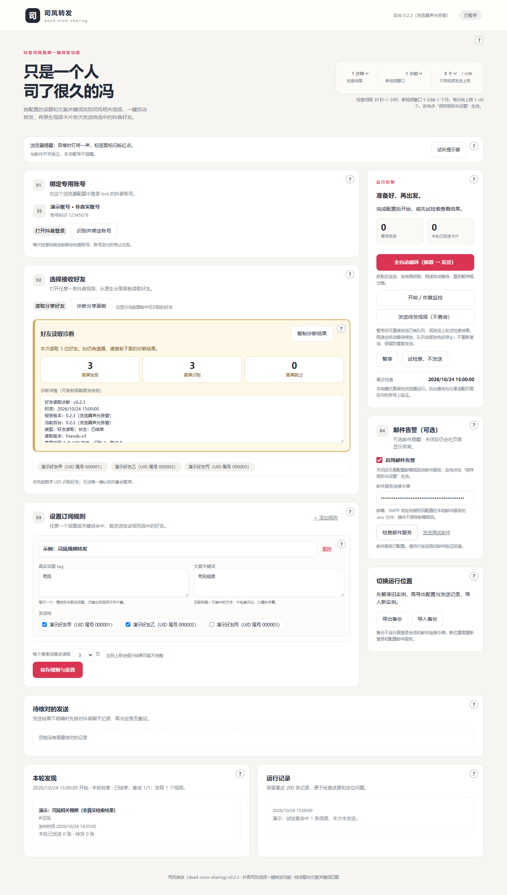
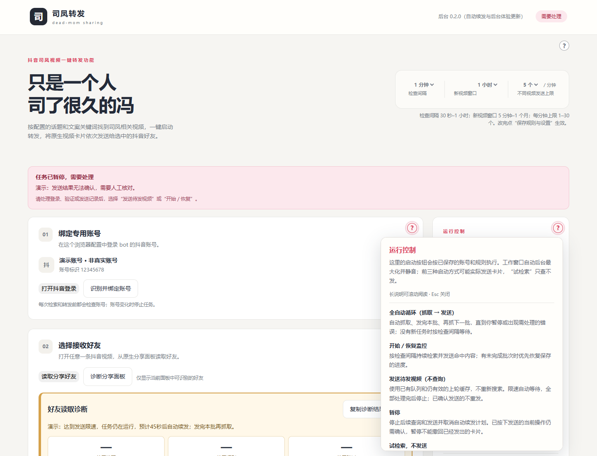
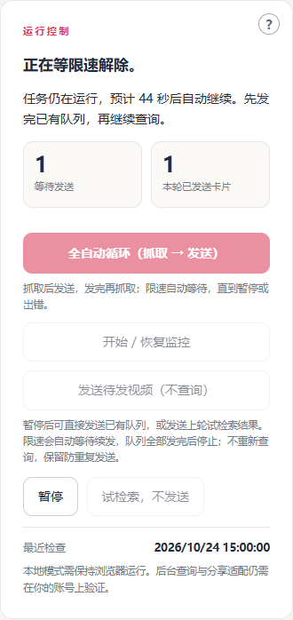
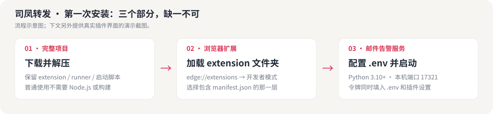
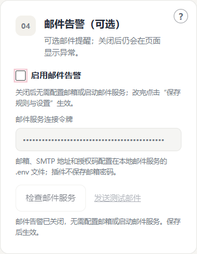
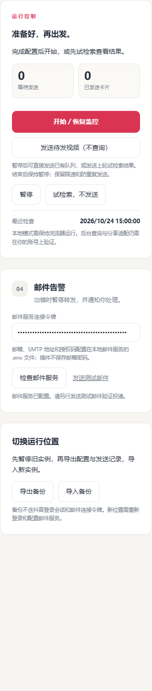
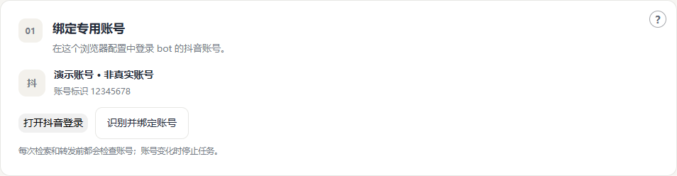
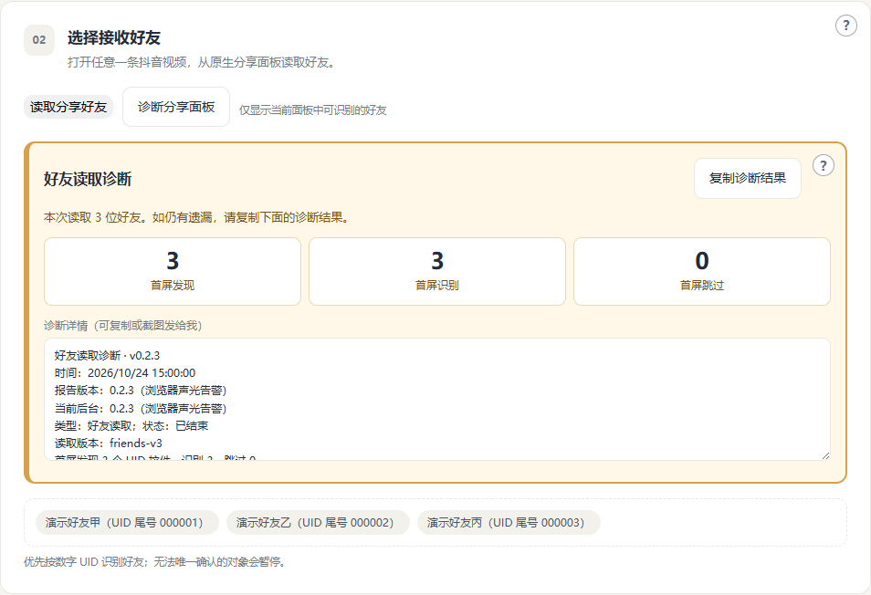
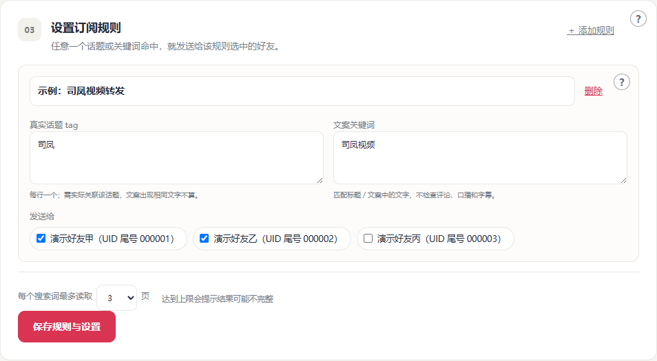

# 司凤转发（dead-mom sharing)

> 只是一个人司了很久的冯

**抖音司凤视频一键转发功能。** 把你想分享的司凤相关视频整理成待发列表，选好接收好友后，点击“发送待发视频（不查询）”，即可依次转发原生视频卡片。上轮已经找到的视频可以直接继续发，同一视频发给多位好友也会复用同一页面，减少反复搜索和逐人刷新。

内容范围由你配置的抖音真实话题和标题／文案关键词决定。首次完成账号绑定、好友选择和规则配置后（邮件告警可选），既可以手动一键发送这一轮，也可以开启定时检索，让新命中的视频按规则进入队列。这里的“一键”指启动已配置好的转发流程，视频仍会按好友逐个发送、逐个确认，并保留限速与去重。

这是一个开源的 Chrome / Edge 扩展，可选配套本地邮件告警服务。你在自己的浏览器中登录和运行；出现验证码、账号变化或发送结果不明时，任务会暂停，交给你处理。

**当前版本：0.2.3 · 浏览器声光告警 · 试用阶段 · MIT 许可证。** Windows + Edge 已有实际使用反馈，仍存在网页适配和偶发暂停问题；不承诺全天候无人值守。Ubuntu 部署文件已提供，尚未完成服务器实机验收。完整验证边界见 [TESTING.md](TESTING.md)。



*上图及本文所有界面截图均由真实插件界面生成，使用虚构演示账号、好友和视频，不包含真实用户信息，也不代表真实发送结果。*

**v0.2.1 更新要点：** 邮件告警可选，手动暂停不再误发告警。升级步骤和下载文件见 [更新日志](CHANGELOG.md)。

**v0.2.2 更新要点：** 搜索遇到“请选择所有符合上文描述的图片，并拖拽到下方”验证时，会暂停并显示需人工验证的提示；即使搜索请求仍在等待也能识别。试检索同样保留页面告警，邮件仅在启用时通知。

**v0.2.3 更新要点：** 真正异常暂停时播放一次原创“叮咚”提示音，设置页标签图标右上角闪烁红点，标题显示“待处理”，工具栏保留告警标记。声音不依赖邮件服务；手动暂停不提醒，处理问题并恢复后清除标记。

### 浏览器声音与红点提醒

发生验证码、账号异常或发送结果不明等真实告警时，浏览器响一次叮咚。设置页关着仍能播放；设置页打开时标签图标闪烁红点，工具栏告警标记会保留，点击扩展图标可回到设置页处理。可将扩展固定到工具栏方便查看。

“试听提示音”只播放本地声音，不发视频、不发邮件，也不会启动任务。同一告警不会因刷新设置页、多开页面或邮件重试而重复响。正常限速等待和手动暂停不触发声音；处理实际问题并成功恢复后，红点、标题和工具栏标记清除。


声音与邮件开关独立，继续保持抖音工作标签静音。播放被浏览器拒绝时，页面会保留告警并提示检查声音；系统或浏览器静音不一定报错，请用试听确认能听到声音。标签页进入睡眠或后台被节流时，闪烁可能延迟，工具栏标记仍保留。此功能使用新增的 `offscreen` 权限播放扩展内置音频，不连接外部声音服务。

**v0.2.0 更新要点：** 全自动抓取／发送循环、限速自动续发、查询分段续查、失效视频跳过、区域问号说明，以及后台窗口最大化与静音。完整变化和旧版升级步骤见 [更新日志](CHANGELOG.md)。

### 每个区域的使用说明

每块区域右上角都有一个 **圆圈问号**。鼠标移到问号上，会显示本区用途、每个按钮及参数的详细说明；鼠标离开问号和说明浮窗后自动隐藏。长说明可将鼠标移进浮窗滚动阅读，也可按 Esc 关闭。键盘用 Tab 聚焦问号时也能查看，触屏可点问号、点空白处关闭。

顶部参数、账号、好友、诊断、订阅规则、每张规则卡片、运行控制、邮件、备份、待核对、本轮发现和运行记录均提供对应说明。查看说明不会启动任务、保存配置或发送卡片／邮件。



## 从这里开始

| 你想做什么 | 从哪一节开始 |
| --- | --- |
| 第一次安装，能复制命令即可 | [安装](#install) → [按需配置邮件](#mail) → [首次使用](#first-run) |
| 已装好，想直接测试上轮找到的视频 | [四种运行方式](#run-modes) |
| 出错、找不到好友、邮件服务连接失败 | [故障排查](docs/TROUBLESHOOTING.md) |
| 让 AI 帮忙安装或维护 | [AI 操作指南](docs/AI_GUIDE.md) |
| 修改代码、运行测试、生成安装包 | [开发指南](docs/DEVELOPMENT.md) |
| 把整理好的项目发布到 GitHub | [发布指南](docs/PUBLISHING.md) |

## 核心功能：抖音司凤视频一键转发

| 使用场景 | 你做什么 | 插件怎样处理 |
| --- | --- | --- |
| 找到想分享的司凤相关视频 | 设置实际话题或文案关键词，点击“试检索，不发送” | 查询并展示命中视频，保留上轮结果供核对 |
| 把这一轮视频直接发出去 | 在暂停状态点击“发送待发视频（不查询）” | 使用已有队列和仍有效的缓存，不重复查询；限速自动等待，全部发完后停止 |
| 同一视频发给多位好友 | 在规则中勾选多位接收人 | 同页依次发送并确认，发完该视频再切下一个 |
| 完全自动循环 | 点击“全自动循环（抓取 → 发送）” | 抓取后发送，队列发完后再抓取下一轮；限速自动等待，直到暂停或出错 |
| 持续留意新视频 | 点击“开始／恢复监控” | 按设置周期检索、匹配、入队和发送 |
| 中途暂停后继续 | 先处理待核对记录，再选择恢复或待发直发 | 优先完成当前视频的剩余好友，已确认发送的记录不会重新发送 |

### 本轮统计与发现结果

- 运行控制的“本轮已发送卡片”只统计当前这一轮确认发送的卡片，不累加历史记录。同一视频发给 3 位好友，算 3 张卡片。
- 一轮完整检索及其自动续段共用同一轮统计，分段查询、发送和限速等待不会清零。新的完整检索、试检索或待发直发才重新计数；仅刷新设置页不会清零，暂停／结束后保留该轮结果。
- “本轮发现”显示本轮开始时间、查询进度和实际视频数量，搜索每完成一个查询词便更新；失败时保留已找到的部分结果，零结果会明确显示，不再停留在上一轮。
- 待发直发和续发当前视频不重新搜索，此区域显示这次待发清单，并标注“不重新查询”；“最近检查”仍是最近一次完整检索时间。
- 列表区分“本轮已发送”和“此前已发送”；页面在点击前已经显示发送过的记录，只保留防重，不算本轮新发送。待核对不算成功，本轮的记录经人工确认已发送后才计入。
- 历史发送记录和原有限速、去重规则持续保留；导入的历史统计不会当成本机新一轮。

### 全自动循环与限速等待

点击显眼的 **“全自动循环（抓取 → 发送）”** 后，插件自动按当前规则抓取，抓取后发送，队列全部发完再进入下一轮抓取；有未完成的批次时优先恢复进度。直到你点击“暂停”或遇到需要处理的错误，任务才停止。若没有新的待发视频，会按“检查间隔”等待后再抓取，避免空转。

**达到配置的发送限速不会暂停任务。** 界面显示“等待限速”和预计自动继续时间，限速解除后继续剩余好友；浏览器可能稍晚唤醒，无需重复点击。工作片段的时限或数量限制也只会触发自动续段，不会丢弃队列或重发已确认记录。等待期间仍可立即暂停。



### 查询预算用完时会怎样

正常监控按“查一段 → 发完已找到的队列 → 继续下一段”执行。每完成一个查询词就保存结果、入队和下一个查询词的位置。接近单段时限时暂停查询，使用剩余时间发送；时间或限速不足则自动安排续段。队列全部处理完后从下一个未完成的查询词继续，不重查已经完成的词，也不重发已经确认的好友。

“本轮发现”显示累计查询进度和当前阶段，如“等待发送剩余队列”或“队列已发完，将自动继续剩余查询”。自动续段保留本轮已发数量；“最近检查”只有完成全部查询词后才更新。单个查询词仍按配置的分页上限读取，达到分页上限不代表该词全量结果已经查完。

手动暂停会停止自动续段，恢复监控后继续保存的进度。修改查询规则、分页上限、视频窗口或绑定账号会清除旧查询进度；历史发送记录继续用于防重。验证码、账号变化和回执不明仍暂停并告警。

**试检索仍只查不发**：预算不足时显示部分结果，保留位置，再次点击试检索继续。“发送待发视频（不查询）”始终不查询，自动等待并发完剩余队列后停止。

### 视频被删除、下架时会怎样

发送前，如果当前视频页面明确显示 **“你要观看的视频不存在”**、作品已删除／下架或已识别的违规不可播放提示，会跳过该账号下这条视频的所有剩余待发好友，继续后面的队列；前面已成功发送的记录保留。这属于正常跳过，不会因此暂停或发送告警。

“本轮发现”会单独显示 **“失效跳过 X 项”**，诊断和运行记录说明原因；跳过不计入已发送数量。失效标记会保存，后续搜索仍返回同一视频或新增接收人时，也不会重新入队。这里的 X 是待发好友任务数，不是视频数。


只有明确的页面失效证据才会跳过。网络慢、找不到分享入口、验证码和账号变化仍按各自流程处理；**已经点击发送后结果不明，仍须人工核对**，不会自动跳过或重发。尚未识别的页面提示仍可能暂停，请提供提示文字供适配。

### 配套能力

- **话题订阅**：匹配视频实际关联的结构化话题，文案里恰好出现同样文字不等于关联该话题。
- **关键词订阅**：匹配视频标题／文案；同一规则中任意话题或关键词命中即可。
- **指定好友**：每条规则可选不同接收人；当前面板优先按数字 UID 识别，同名好友也能区分。
- **原生卡片**：通过视频原生分享面板操作，接收的是视频卡片，不以文字链接代替。
- **防重复**：同一账号、同一视频、同一好友只处理一次；多条规则命中会合并接收人。
- **同页连续发送**：同一视频依次发给多位好友，逐人确认，发完再切下一个视频，不逐人刷新。
- **待发直发**：使用已有队列或上轮检索缓存，省去重复搜索，适合调试。
- **分段查询、发完续查**：查询预算不足时保存下一个查询词的位置，先发送已找到的视频。已有队列全部处理完后自动继续剩余查询，不再因预算不足暂停告警。限速时先等发送，不提前继续堆积查询。
- **有限恢复**：每位当前待发好友在点击发送前缺少分享入口、好友行或转发按钮时，最多刷新当前视频页两次（共三次页面尝试）；仍失败才暂停告警。已发好友不重发。
- **暂停与告警**：登录失效、验证码、账号不符、适配失败或回执不明时暂停，并尝试邮件通知。
- **可复制诊断**：界面保留最近报告、实际后台版本和运行记录，方便人类或 AI 排查。

当前**不检索评论、口播、字幕或私信内容**，不解决验证码，不绕过登录或限流。检索完整度取决于平台索引、分页上限和网页结构，检查频率不等于新视频一定能被发现的速度。请用于你有权操作的账号及愿意接收内容的好友。

<a id="install"></a>
## 一、安装：下载完整项目并加载扩展

### 1. 准备环境

| 项目 | 普通 Windows 用户需要什么 |
| --- | --- |
| 浏览器 | 桌面版 Edge 或 Chrome；扩展清单要求 Chromium 120+，允许开发者模式与调试权限 |
| Python（可选） | 仅启用本地邮件服务时需要 3.10 或以上；关闭邮件告警时无需安装 |
| 邮箱（可选） | 仅启用邮件告警时需要 SMTP 服务、授权码／应用密码及收件地址 |
| 抖音 | 在此浏览器配置中正常登录的账号，可在网页端向目标好友分享视频 |
| Node.js | **普通安装不需要**；仅开发、测试和打包时需要 |

需要 Python 时，从 [Python 官方 Windows 下载页](https://www.python.org/downloads/windows/) 安装。装好后打开 PowerShell，执行 `python --version`，确认输出版本。若只有 `py` 命令可用，下文 Python 命令可改用 `py -3`。

### 2. 下载和解压

在 [v0.2.3 下载页](https://github.com/hormosieid-keer/dead-mom-sharing/releases/tag/v0.2.3) 下载 **`dead-mom-sharing-0.2.3.zip` 完整安装包**。也可以在仓库页面通过 **Code → Download ZIP** 下载源码，解压后使用。已有用户的升级步骤见 [更新日志](CHANGELOG.md)。

`dead-mom-sharing-extension-0.2.3.zip` **只有浏览器扩展**，不包含本地邮件服务；不使用邮件告警，或已有邮件服务的用户可单独使用它。

解压后，你应该能在同一个文件夹中看到：

```text
dead-mom-sharing/
├─ extension/           ← 浏览器要加载这个文件夹
│  └─ manifest.json
├─ runner/              ← 本地邮件服务
├─ .env.example         ← 邮件配置模板
├─ start-mail.ps1       ← Windows 启动脚本
└─ README.md
```

选择一个固定存放位置。安装后浏览器会继续读取该目录，**不要只在压缩包内查看，也不要安装完就删除解压目录**。



### 3. 在浏览器里加载

1. 在你准备用来运行插件的浏览器配置中操作；建议使用专用配置，便于区分账号。
2. Edge 地址栏输入 `edge://extensions`；Chrome 输入 `chrome://extensions`。
3. 打开**开发者模式**，点击**加载已解压的扩展程序**。
4. 选择解压目录中的 **`extension` 文件夹**，这一层必须直接包含 `manifest.json`。不要选项目根目录或 ZIP 文件。
5. 从浏览器的扩展菜单中打开“司凤转发（dead-mom sharing)”，进入设置页。可把扩展固定到工具栏。
6. 页面顶部应显示 **`后台 0.2.3（浏览器声光告警）`**。版本不同或提示后台未知，先重新加载扩展并刷新设置页。

扩展使用浏览器调试接口模拟原生分享面板需要的指针悬停。浏览器可能显示“正在调试此浏览器”等提示，这是使用 `debugger` 权限时的提示；操作结束后会断开调试会话。不要同时打开工作标签的开发者工具。

<a id="mail"></a>
## 二、配置邮件服务（可选）

不需要邮箱提醒时，保持 **“启用邮件告警”关闭并保存**，即可跳过本节：无需 Python、邮箱、连接令牌或本地邮件服务，也能监控、全自动循环和待发直发。新安装默认关闭；旧版已有连接令牌会保留启用状态，可自行关闭。关闭后，异常仍会暂停并在页面提示，不发送或重试告警邮件。



只有勾选“启用邮件告警”时才需要以下配置。启用后，SMTP 配置和连接令牌未就绪会阻止启动；“检查邮件服务”只检查连接和配置，实际投递要通过“发送测试邮件”另行确认。手动暂停本身不会触发告警。

### 1. 创建配置文件

在解压后的项目文件夹空白处打开 PowerShell，或先切换到该文件夹。执行：

```powershell
# 已有 .env 时保留原配置
if (!(Test-Path -LiteralPath .env)) { Copy-Item .env.example .env }

# 生成一串随机连接令牌；复制输出，供下一步使用
python -c "import secrets; print(secrets.token_urlsafe(32))"

# 使用记事本编辑本地配置
notepad .env
```

填写以下字段。模板中的占位文字不能直接用于登录；端口、加密方式和授权码以你的邮箱提供方说明为准。

```dotenv
BOT_BRIDGE_TOKEN=粘贴刚生成的随机令牌
SMTP_HOST=填写邮箱的SMTP服务器
SMTP_PORT=465
SMTP_SECURITY=ssl
SMTP_USER=填写SMTP登录账号
SMTP_PASSWORD=填写SMTP授权码或应用密码
SMTP_FROM=填写发件邮箱
ALERT_EMAIL_TO=填写接收告警的邮箱
```

| 字段 | 如何填写 |
| --- | --- |
| `BOT_BRIDGE_TOKEN` | 上一步生成的随机串，至少 32 个字符；插件中也要填写**完全相同**的值 |
| `SMTP_HOST` | 邮箱服务的 SMTP 主机名，不是网页版邮箱地址 |
| `SMTP_PORT` / `SMTP_SECURITY` | 常见组合为 `465` + `ssl`，或 `587` + `starttls`；必须按提供方要求配对 |
| `SMTP_USER` / `SMTP_PASSWORD` | 通常是完整邮箱地址及 SMTP 授权码／应用密码；授权码可能与网页登录密码不同 |
| `SMTP_FROM` | 发件地址，应符合邮箱提供方对该 SMTP 账号的要求 |
| `ALERT_EMAIL_TO` | 收到暂停告警和测试邮件的地址 |
| `BOT_VNC_PASSWORD` | Windows 本地使用可以留空，仅远程桌面部署需要 |

一行一个 `KEY=VALUE`，按字面填写；不要填成 PowerShell 命令。`.env` 只放在本机，**不要上传 GitHub、贴到 Issue 或交给 AI 输出到聊天中**。

### 2. 启动邮件服务

仍在项目根目录运行：

```powershell
python -m runner.mail_bridge
```

也可以运行 `./start-mail.ps1`。如果你的 Python 命令是 `py -3`，可使用 `py -3 -m runner.mail_bridge`。本地邮件服务只使用 Python 标准库，**不需要安装 `requirements-runner.txt` 或 Playwright**。

保持这个窗口运行。服务默认监听 `127.0.0.1:17321`。关闭窗口、停止 Python 或关闭电脑都会停止本地邮件服务；修改 `.env` 后需要重启该服务。

### 3. 在插件中验证

1. 在插件中勾选“启用邮件告警”，把 `.env` 中的 `BOT_BRIDGE_TOKEN` 填入插件右侧的**邮件服务连接令牌**。
2. 点击**保存规则与设置**。
3. 点击**检查邮件服务**：确认本机连接、令牌与配置有效，此按钮不会发邮件。
4. 点击**发送测试邮件**：这是一次真实邮件发送，检查收件箱及垃圾邮件。



<a id="first-run"></a>
## 三、第一次使用：登录 → 读取好友 → 设规则 → 试检索

### 1. 登录并绑定账号

点击**打开抖音登录**，在同一个浏览器配置中手动登录。登录完成后点击**识别并绑定账号**，核对显示的账号就是你想用来发送的账号。



### 2. 读取好友

1. 在抖音网页中手动打开一条可分享的具体视频。不要停留在搜索结果列表或空白页。
2. 回到插件，点击**读取分享好友**。这一步只读取，不发送。
3. 扩展会展开原生分享面板、回到列表顶部，并滚动收集可识别的好友。等待按钮恢复可点击后再操作。
4. 查看按钮下方的**好友读取诊断**。首屏和累计数量应与当前分享面板相符；有跳过或未扫完时，先复制诊断排查。

这里只能读取抖音原生分享面板实际提供的对象，**不等于导出完整的抖音通讯录**。读取结果按数字 UID 优先绑定，名字仅用于显示；不要手工修改 UID。



### 3. 添加规则并勾选接收人

每条规则至少填写一个话题或关键词，并勾选至少一位好友；完成后点击**保存规则与设置**。

| 输入 | 示例 | 匹配方式 |
| --- | --- | --- |
| 真实话题 tag | `司凤`，每行一个，不必加 `#` | 视频实际关联该话题才匹配；请以平台实际存在的话题为准 |
| 文案关键词 | `司凤视频`，每行一个 | 标题／文案包含该文字；英文不区分大小写 |
| 发送给 | 勾选演示好友甲、乙 | 该规则命中后，分别给所选好友发送 |

同一规则的多个条件是 **“或”**：上面示例表示，关联“司凤”话题，**或者**文案包含“司凤视频”，就会命中；不是要求两者同时出现。这里仅展示填写方式，请按你实际想找的视频调整规则。不同规则命中同一视频时，对同一接收人只处理一次。



### 4. 先试检索，再开始发送

首次使用建议只选一位同意接收测试内容的好友，并把新视频窗口设小。

1. 点击**试检索，不发送**。
2. 查看“本轮发现”和“运行记录”，核对话题、视频发布时间及数量。**试检索不会发送视频，但会打开工作页面进行查询。**
3. 确认结果正确后，可点击**发送待发视频（不查询）**测试这一轮，或点击**开始／恢复监控**持续运行。
4. 首次真实转发后，在对方聊天记录中核对收到的是正确视频卡片和正确接收人。

**开始监控可能立即发送当前窗口内已经发布的视频，不只是从点击开始之后的新视频算起。**

<a id="run-modes"></a>
## 四、四种运行方式，以及日常使用方式

| 按钮 | 查询新视频 | 发送视频 | 结束后 |
| --- | --- | --- | --- |
| **试检索，不发送** | 是 | 否 | 显示预览；不会因此开启监控 |
| **发送待发视频（不查询）** | 否 | 是：已有队列 + 仍有效的上轮缓存 | 限速／分段自动续发，全部发完后停止 |
| **全自动循环（抓取 → 发送）** | 是 | 是 | 队列发完再抓取下一批；直到手动暂停或出错 |
| **开始／恢复监控** | 是；有中断的当前视频时优先续发 | 是 | 按设置周期继续运行 |

**待发直发会自动等限速、自动继续发送，直到队列全部发完。** 它只使用已有队列和仍有效的缓存，不重新查询，也不在发完后转为监控。要持续“抓取 → 发送 → 抓取”，请使用全自动循环按钮。

开始待发直发前先暂停其它模式；有“待核对”记录时必须先人工处理。已入队任务不会因为视频变旧自动丢弃；从缓存新加入的结果仍须符合当前规则和视频窗口。等待期间保持浏览器运行；启用邮件告警时也保持邮件服务运行，随时可以点击暂停。

### 顶部三项节奏设置

| 设置 | 默认 | 可选范围 | 影响 |
| --- | --- | --- | --- |
| 检查间隔 | 1 分钟 | 30 秒–1 小时 | 多久开始一次新检查，实际运行也受上一轮耗时影响 |
| 新视频窗口 | 1 小时 | 5 分钟–30 天 | 新发现的视频在入队时允许多旧 |
| 不同视频发送上限 | 5 个／分钟 | 1–30 个 | 任意连续 60 秒内最多处理的不同视频数 |

同一视频发给多位好友只占一个“不同视频”额度，但会产生多张卡片。设置改完后要保存；规则和节奏请在暂停时修改。

### 保持运行与后台窗口

- 本地模式需要浏览器和电脑保持运行；仅启用邮件告警时需要邮件服务保持运行；电脑休眠、关机或浏览器关闭后不会继续工作。
- 自动查询／发送使用独立的抖音工作窗口，创建后自动在后台最大化，工作标签页静音，保留当前窗口的焦点。新窗口先打开空白页，确认静音后再加载抖音，避免加载视频时短暂出声。复用已有工作窗口或同视频页面时也会检查，窗口被缩小、取消静音后会重新设置，同视频不会为此刷新。只处理程序的工作标签页，不改变其他标签页的声音。请保留这个窗口；页面受遮挡及后台渲染限制时仍可能暂停。
- 在浏览器的性能／系统设置中将抖音加入不休眠例外，或按需关闭睡眠标签页／效率模式；界面名称可能随浏览器版本变化。
- 同一视频发给多位好友时复用当前页面。发送中途也能恢复：当前好友在发送前缺少分享入口、好友行或转发按钮时，最多刷新两次（初次尝试加两次重试）；三次均失败才暂停并告警。不会从头重发本视频的其他好友。验证码、账号变化、目标不唯一，以及已经点击发送但回执不明仍立即暂停，避免误发或重复发送。
- 不要同时启用两个独立实例，否则它们看不到彼此新增的发送记录，可能重复发送。

## 五、暂停、人工核对和恢复

发生异常时先读红色暂停原因，再看“好友读取诊断”和“运行记录”。不要反复点击恢复。

**“发送结果无法确认”不等于“没有发送”。** 先在目标好友的聊天记录中核对，再处理：

| 你核对到的情况 | 选择 |
| --- | --- |
| 视频卡片已经收到 | **核对后标记已发送** |
| 确定没有收到，需要重发 | **确认未发送，重试** |
| 本条不再发送给这位好友 | **跳过这位好友** |


这些按钮是你作出核对结论，不是插件替你判断。处理完成、登录／验证码等问题也解决后，再选择恢复监控或待发直发。**已经按下发送但回执不明时，程序不会自动刷新重发。**

常见问题的完整处理步骤见 [故障排查](docs/TROUBLESHOOTING.md)。提交 Issue 前先去掉账号、好友、邮箱和凭证；模板会提示需要哪些诊断。

## 六、升级、备份和迁移

**更新代码后必须重新加载扩展。** 暂停并等待当前操作结束 → 备份 → 在原位置更新文件 → `edge://extensions` / `chrome://extensions` 点“重新加载” → 刷新设置页 → 核对顶部版本。仅刷新抖音网页不会加载新的后台代码。

设置页支持“导出备份／导入备份”。备份包含规则、接收好友和发送记录，**不含**抖音登录会话、SMTP 授权码和邮件连接令牌。它仍包含个人关系和视频记录，请私下保存，不要上传仓库。

迁移电脑或浏览器配置时，先暂停旧实例再导出；在新位置安装、导入、登录相同账号，启用邮件告警时再配置邮件服务。导入后不会替你自动开始发送。不要通过卸载扩展排查一般故障，以免丢失浏览器中的配置和记录。

## 七、数据、权限和许可证

| 内容 | 存在哪里 |
| --- | --- |
| 抖音登录会话 | 你使用的浏览器配置中；插件不要求你提供 cookie |
| 账号绑定、好友、规则、待发／已发记录、诊断、连接令牌 | 扩展本地存储 |
| SMTP 凭证和告警收件人 | 本机 `.env` |
| 邮件告警去重记录 | 本机 `data/alerts.sqlite3`，可通过 `BOT_DATA_DIR` 改位置 |

扩展权限及原因见 [安全说明](SECURITY.md)。正常使用会访问抖音；仅启用邮件告警时访问 `127.0.0.1:17321`，邮件服务会连接你配置的 SMTP 主机；本项目未内置分析统计或第三方数据上传服务。

本项目采用 [MIT 许可证](LICENSE)。引用的上游来源与许可证保存在 [THIRD_PARTY.md](THIRD_PARTY.md) 和对应 licenses 目录。没有抖音官方背书；网页变化可能需要维护适配层。

## 八、开发者、AI 与服务器部署

- [开发指南](docs/DEVELOPMENT.md)：目录结构、测试、截图生成、打包、后台协议和版本规则。
- [AI 操作指南](docs/AI_GUIDE.md)：让 AI 按顺序安装、验证与定位故障，区分读操作和实际发送。
- [AGENTS.md](AGENTS.md)：仓库内供编码代理读取的约束和入口。
- [贡献指南](CONTRIBUTING.md)：报告问题、提交修改与验证。
- [发布到 GitHub](docs/PUBLISHING.md)：干净源码目录、源码包、Release 附件和上传前检查。
- [Ubuntu / Docker 部署](deploy/RUNNING.md)：可选远程浏览器和人工验证码接管；当前尚未完成服务器实机验收，首次使用优先采用上面的 Windows 本地流程。

普通用户到此即可开始使用，无需执行开发构建。开发者快速检查：

```sh
npm ci
npm test
python -m unittest discover -s tests -p "test_*.py" -v
npm run docs:check
npm run package
npm run package:github
npm run release:verify
```

上述离线测试和打包不会给真实好友或邮箱发送消息；需要浏览器的独立模拟联调命令及其端口要求，见开发指南。
